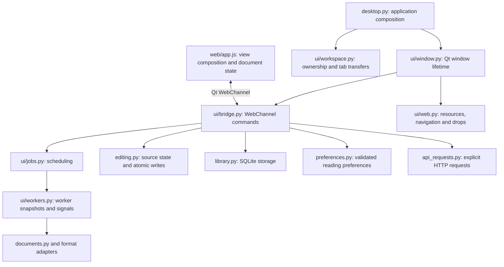

# Architecture

Khana is a desktop application with a native Python/Qt host and an offline
HTML/CSS/JavaScript view. Python owns files, durable state, worker scheduling and
window lifetime. JavaScript owns editor interaction and rendered views. A source
buffer and its preview are different representations: saving always uses the
source, never the sanitized preview HTML.

## Module ownership



| Module | Responsibility and boundary |
| --- | --- |
| `reader/desktop.py` | CLI, application metadata, single-instance service and top-level composition. |
| `reader/resources.py` | Paths to bundled resources, shared by source and frozen builds. |
| `reader/ui/window.py` | Construct the WebEngine profile, page, channel and bridge; join workers before closing. |
| `reader/ui/workspace.py` | Reserve document paths across windows, select a target window and coordinate acknowledged transfers. A supplied `window_factory` avoids importing the concrete window at runtime. |
| `reader/ui/bridge.py` | Native command facade: synchronize the latest source, validate operations, display save/close prompts, and publish session/library events. Qt slot names intentionally match the JavaScript contract. |
| `reader/ui/jobs.py` | Own each window's serial worker pool, deduplicate work, coalesce pending previews, and discard results for closed documents or a stopped window. |
| `reader/ui/workers.py` | Execute snapshots and emit results. Workers never access widgets, the session dictionary or SQLite. |
| `reader/spelling.py`, `reader/ui/spelling.py` | Load bundled Hunspell dictionaries lazily, cache lookup results, and check words on a separate serial worker pool. |
| `reader/documents.py` | Load supported formats, preserve source metadata, render previews and sanitize HTML. Word/PDF/OpenAPI details live in their existing adapters. |
| `reader/editing.py` | Buffer baseline, dirty state, conflict detection and atomic file replacement. This uses QtCore's `QSaveFile`, but has no dependency on windows or the WebChannel. |
| `reader/library.py` | Store documents, annotations and workspace paths. `get(path)` reads only that document and its annotations; `entries()` deliberately reads the full library view. |
| `reader/preferences.py` | Normalize untrusted persisted preferences without Qt. Invalid fields fall back independently; numbers must be finite and bounded. |
| `reader/api_requests.py` | Validate and execute explicit API requests, enforce limits, handle cancellation and release replies. It is separate from browser resource loading. |

Document services do not import `reader.ui`. Native modules use explicit imports
instead of reaching through the application entry point. The bridge coordinates
operations; it does not contain worker implementations. Cross-window callers use
`sync_source`, `release_session`, `remember_workspace` and `publish_library` rather
than reaching into private bridge helpers.

## Browser composition

`index.html` loads first-party modules in dependency order and loads `app.js`
last. No frontend build step is required to run or package the application.
Factories receive the state accessors and callbacks they need. They do not import
the application composition module. ESLint declares the shared `Reader*` globals
explicitly; adding a module means adding its script and, if used elsewhere, its
global declaration.

| Module | Owned behavior |
| --- | --- |
| `app.js` | Document map, active document, preview revisions, save/close coordination, native event wiring and command dispatch. |
| `source-editor.js` | Textarea lifecycle, cursor state, editing mode, undo-preserving source operations, formatting and link/builder dialogs. |
| `search.js` | Search results, highlight ranges, result navigation and search-panel controls. |
| `outline.js` | Heading buttons and the active-heading observer. |
| `line-numbers.js` | Visible editor/reading line numbers and shared, wrap-aware source measurements for navigation and scroll sync. |
| `file-list.js` | File rows, dirty indicators, close/detach buttons and drag gestures. |
| `window-controls.js` | Native move, minimize and fullscreen gestures. |
| `workspace.js` | Extra reading panes and their mounted document views. |
| `pdf-pages.js` | Shared page request/response lifecycle for every PDF pane. |
| `pdf-ui.js` | PDF text-editing controls and validation dialog. |
| `openapi-ui.js`, `api-requests.js` | Retained Swagger views and request promises, independently of which tab is visible. |
| `library-ui.js`, `annotations.js` | Library controls and text anchors. |
| `formatting.js`, `insertions.js`, `bidi.js` | Text transformations and direction rules, with Node-testable exports. |
| `i18n.js`, `fa.js`, `pickers.js` | Translate application controls, mirror the interface, and render accessible language and format menus. UI translation excludes document text and user labels. |
| `spelling.js` | Debounced source checking, mirrored underlines, scoped ignore actions and undoable suggestions. Results must match the active document and source snapshot. |
| `structures.js`, `builders.js` | Locate and safely replace existing tables/diagrams, preserve cell metadata, and edit tables and supported flowcharts. Unsupported structures retain a source editor. |

Other existing feature modules own sidebar layout, preview zoom, scroll mapping,
diagram rendering and builder forms. `window.readerApp` remains the narrow
application API used by desktop smoke checks.

## Asynchronous invariants

1. A queued file open reserves its resolved path immediately. A second open is
   routed to that owner, and Save As cannot replace a reserved path.
2. Typing increments a document's preview revision before the debounce runs.
   At most one preview per document runs; only the newest queued snapshot is
   retained. The UI accepts a result only when its revision still matches.
3. Workers operate on captured strings and paths. Their Qt signals return to the
   owning UI thread, where queue bookkeeping and session changes happen.
4. Closing a document discards its queued preview, cancels API requests and
   suppresses late job results. An in-flight preview, formatting or PDF worker
   reserves its document ID so reopening the same path cannot receive the old
   session's results. Closing a window rejects new work, stops result delivery
   and joins its workers before their signal owners can be destroyed.
5. Each PDF mount captures document ID, source and revision. Disposing a mount
   disconnects its observers and invalidates callbacks. The first page is
   requested immediately, even if Chromium defers visibility callbacks; later
   pages are requested near the visible area. Responses must match the current
   mount. Main and extra panes use the same implementation.

### Tab transfer

`TabTransfer` makes the transfer state explicit. The origin retains its session
while the browser locks editing and waits for its current preview and API requests.
`prepareTransfer` captures the final source and view state; the manager copies the
session and delivers it after the target bridge is ready. The receiving browser
mounts the document and acknowledges it with `acceptTransfer`. Only that
acknowledgment removes the origin's buffer. An early acknowledgment is ignored.
Timeout or invalid preparation removes any delivered copy and unlocks the origin.
Save, reload, close and quit respect this transition.

Qt owns the native `QDrag` event loop and drag-object cleanup. Do not install a
Python application-wide event filter to observe drag cancellation: wrapping
Qt's internal objects during their lifetime changes can crash PySide/Shiboken
before the Python callback runs. An ignored drop detaches only after the left
mouse button is released outside the source. The manager rejects reentrant
drag requests. `tab_drag_smoke.py` exercises the real loop on X11/XWayland;
the mocked completion cases in `workspace_smoke.py` alone cannot cover it.

## State and resource policy

`reader.VERSION` is the application version shared by the CLI, Qt metadata and
package builders. The browser reads the bridge's constant `appVersion` property
through WebChannel. It must not embed a separate version string. Debian packaging
also checks the unpacked executable's version before creating installer metadata.

| State | Lifetime |
| --- | --- |
| Source files | Written only by successful Save/Save As operations. |
| Library, stars, notes and reopenable workspace paths | SQLite beside `settings.ini`. Unsaved drafts are not persisted. |
| Reading preferences and native geometry | QSettings; source runs use `.local`, frozen builds use the platform configuration directory. |
| Spelling exceptions | QSettings for global words and saved document paths; draft exceptions stay in memory until saving. |
| Editor selections, undo history, pane positions and API credentials/responses | In memory for the open session. API runtime state is never written to settings or source. |
| PDF originals, edits and rendered page images | Process-local temporary cache. PyMuPDF access is serialized by a shared lock across window pools. |

The WebEngine interceptor permits bundled assets, local images, `data:` and `qrc:`
resources. It blocks remote resource requests. Sanitization removes executable
document content; external links require a user navigation action. API execution
uses the separate native HTTP transport. Local images may be outside the document
folder, matching image insertion behavior.

## Extending the application

- For a format, update the format/extension definitions and the load/render/save
  dispatch in `documents.py` and `editing.py`. Keep expensive conversion in a
  format adapter, and preserve source encoding metadata. Add parser/save tests
  and a desktop scenario for the visible behavior.
- For a browser feature, add a focused factory module with explicit callbacks,
  load it before `app.js`, and compose it there. Keep transient DOM state in that
  feature. If it owns observers, timers or requests, define when they stop.
- For a native command, add an explicit Qt slot in the bridge and delegate work
  to the responsible service. Long-running preview/load/render operations belong
  in workers; they must not mutate UI state from a worker thread.
- For a reading preference, update `normalize_preferences`, the UI defaults and
  the relevant controls together. Preserve defaults for existing installations.

## Development checks

Install development dependencies with `pip install -r requirements-dev.txt` and
`npm ci`. Node 20.19+, 22.13+ or 24+ is required by the development lint tools;
Node is not an application runtime dependency. Versions are pinned in the Python
requirements and npm lockfile. Third-party bundles and fonts are excluded from
formatting/linting.

```bash
.venv/bin/ruff check .
.venv/bin/ruff format --check .
.venv/bin/python -m unittest discover -s tests -p 'test_*.py'
npm run check
.venv/bin/python scripts/smoke.py
```

`ruff format .` and `npm run format` apply the repository's style. The desktop
runner executes checks sequentially, records per-check logs and `results.json`
under `artifacts/checks/`, and terminates timed-out processes. A subset can be run
as `python scripts/smoke.py workspace formats`. GUI checks need an active desktop;
the native drag check needs X11/XWayland and Qt's XCB libraries, and Word checks
also need LibreOffice Writer. Keep builds and GUI checks separate to
reduce timing contention. After building both packages, run
`python scripts/smoke.py bundle deb`. Packaged checks isolate configuration and
IPC and do not install the package into the system.

`python tests/performance_smoke.py /path/to/document.md` measures Find, next-result
navigation, Go to line and typing in a temporary copy of a real document. An
optional second argument supplies a baseline source tree. It also asserts that
these interactions execute no SQLite statements. Rendered search text and scroll
maps are invalidated when their content changes, while reading gutters measure
only visible anchors.
